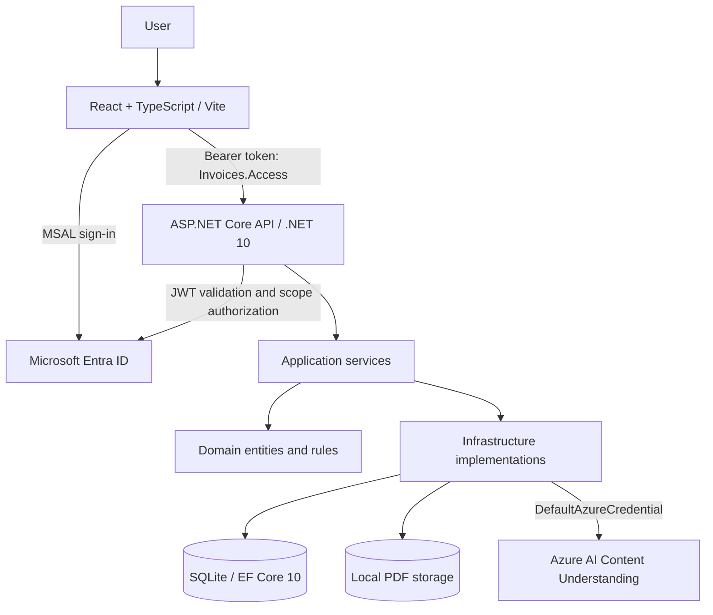

# InvoiceFlow AI

**AI-assisted invoice processing with a human approval step.** Built with **.NET 10**, **React + TypeScript**, **Azure AI Content Understanding**, **Microsoft Entra ID**, and **SQLite**.

InvoiceFlow AI turns a PDF invoice into structured, reviewable data. Users sign in, upload a PDF, ask Azure AI to extract invoice fields, correct any mistakes, and approve the verified invoice. Approved invoices are persisted and displayed in a dashboard.

> **Project status:** Functional local portfolio MVP. This is a demonstration application, not a production accounting or payments system.

<!-- Add screenshots in the final demo step, for example:


-->

## Features

- **Microsoft Entra sign-in:** React uses MSAL; the ASP.NET Core API validates access tokens and requires the delegated `Invoices.Access` scope.
- **PDF upload and storage:** Checks PDF extension, signature, and 10 MB size limit; stores original PDFs on local disk.
- **AI-assisted extraction:** Uses the Azure AI Content Understanding **prebuilt-invoice** analyzer to extract vendor, invoice number, date, total, and currency.
- **Validation and human review:** Applies business rules, displays issues, and lets the user correct extracted fields before approval.
- **Auditable separation:** Retains the original extraction separately from the final, user-approved invoice.
- **Persistent dashboard:** Uses EF Core 10 and SQLite to list approved invoices and summary counts.
- **Authenticated Swagger UI:** Supports Microsoft Entra OAuth authorization-code flow with PKCE for local API exploration.

## Application workflow

1. A user signs in with Microsoft Entra ID.
2. The user uploads a PDF. The API stores the file and creates a `Document` record in SQLite.
3. The user explicitly selects **Analyze**. The API calls Azure AI Content Understanding and stores the extracted values in `ExtractionResults`.
4. The API validates those values and marks the document `NeedsReview` for human verification.
5. The user reviews and edits the proposed values, then selects **Approve invoice**.
6. The API validates the submitted values, saves an `Invoice` record, and marks the document `Approved`.
7. React refreshes the approved-invoice dashboard from SQLite.

**AI output is a suggestion, not an automatic approval.** A successful extraction does not bypass the review step.

## Architecture



The solution separates responsibilities across four backend projects:

| Project | Responsibility |
| --- | --- |
| `InvoiceFlow.Api` | HTTP endpoints, request handling, authentication/authorization, Swagger, dependency injection |
| `InvoiceFlow.Application` | Invoice-processing orchestration, validation, approval contracts and services |
| `InvoiceFlow.Domain` | Core entities and document lifecycle states |
| `InvoiceFlow.Infrastructure` | EF Core repositories, SQLite persistence, local file storage, Azure AI integration |
| `InvoiceFlow.UnitTests` | Focused validation tests |
| `frontend` | React UI, MSAL sign-in, authenticated HTTP client, invoice dashboard and review forms |

### Persistence model

- **Document:** Uploaded PDF metadata and processing state (`Uploaded`, `Processing`, `NeedsReview`, `Approved`, `Failed`).
- **ExtractionResult:** AI-proposed fields and extraction timestamp; a document can have multiple extraction results.
- **Invoice:** Final approved values and approval timestamp; at most one approved invoice per document.

The original AI-extracted values are not overwritten when a user edits and approves an invoice.

## Technology stack

| Area | Technology |
| --- | --- |
| API | ASP.NET Core, .NET 10, C# |
| Frontend | React, TypeScript, Vite, plain CSS |
| AI extraction | Azure AI Content Understanding, prebuilt-invoice analyzer |
| Azure service credentials | Azure Identity `DefaultAzureCredential` |
| User authentication | Microsoft Entra ID, MSAL Browser/React, Microsoft.Identity.Web |
| Database | SQLite, Entity Framework Core 10 |
| API documentation | Swagger UI / Swashbuckle, OAuth 2.0 authorization code + PKCE |
| Tests | xUnit (six focused unit test cases) |

## API endpoints

All invoice and document endpoints require a valid Microsoft Entra bearer token with the delegated `Invoices.Access` permission.

| Method | Route | Description |
| --- | --- | --- |
| `POST` | `/api/documents` | Upload a PDF |
| `GET` | `/api/documents/{id}/file` | Download the original PDF |
| `POST` | `/api/documents/{id}/analyze` | Run AI extraction, validate, and persist the result |
| `POST` | `/api/documents/{id}/approve` | Validate corrected values and save an approved invoice |
| `GET` | `/api/invoices` | List approved invoices |
| `GET` | `/api/invoices/{id}` | Retrieve an approved invoice |

Typical responses include `400` for invalid input, `401` for absent/invalid access tokens, `403` for insufficient authorization, `404` for missing records, and `409` for conflicting document states. A previously approved document cannot be reanalyzed through the normal workflow.

## Running locally

### Prerequisites

- Windows with **Visual Studio** and ASP.NET Core development support (this project has been developed using IIS Express).
- **.NET 10 SDK**.
- **Node.js and npm**, compatible with the installed Vite version.
- An **Azure subscription/resource** with Azure AI Content Understanding access and permission to use its prebuilt-invoice analyzer. Azure AI calls may incur charges.
- A **Microsoft Entra ID tenant** in which you can configure two app registrations and API permissions.
- An Azure developer identity that `DefaultAzureCredential` can use and that has the necessary access to the Azure AI resource.

### 1. Clone and restore

```powershell
git clone <YOUR_REPOSITORY_URL>
cd <YOUR_REPOSITORY_DIRECTORY>
dotnet restore
cd frontend
npm install
cd ..
```

### 2. Create the Microsoft Entra app registrations

Register two **single-tenant** applications in the same directory:

1. **`InvoiceFlowAI-API`** — Expose an API with an Application ID URI such as `api://<API_CLIENT_ID>`, and create the enabled delegated scope `Invoices.Access`.
2. **`InvoiceFlowAI-React`** — Configure a **Single-page application** redirect URI of `http://localhost:5173/`. Under **API permissions**, add the API's delegated `Invoices.Access` permission; grant consent when required by tenant policy.

For local Swagger sign-in, add this second SPA redirect URI to **the React app registration**, replacing the port with the API's actual IIS Express HTTPS port:

```text
https://localhost:<API_HTTPS_PORT>/swagger/oauth2-redirect.html
```

Do **not** create a client secret for the browser application.

### 3. Configure the API

Create or update the git-ignored file:

`src/InvoiceFlow.Api/appsettings.Development.json`

Include an `AzureAd` section with values from your own tenant:

```json
{
  "AzureAd": {
    "Instance": "https://login.microsoftonline.com/",
    "TenantId": "<TENANT_ID>",
    "ClientId": "<API_CLIENT_ID>",
    "Scopes": "Invoices.Access"
  },
  "SwaggerOAuth": {
    "ClientId": "<REACT_CLIENT_ID>"
  }
}
```

**Merge this configuration with the application's existing settings rather than replacing the entire file.**

Also configure the **Azure AI Content Understanding endpoint and any other required AI settings** using the configuration keys expected by the implementation in `InvoiceFlow.Infrastructure` and the API's startup configuration. The exact key names should be checked against the source before publishing a copy-and-paste configuration example. No Azure AI API key or client secret belongs in the frontend.

`DefaultAzureCredential` uses your local Azure developer credentials, subject to the permissions on the Azure AI resource. For example, sign in using your development environment's supported Azure authentication method.

### 4. Configure React

Create or update the git-ignored file `frontend/.env.local`:

```dotenv
API_PROXY_TARGET=https://localhost:<API_HTTPS_PORT>
VITE_ENTRA_CLIENT_ID=<REACT_CLIENT_ID>
VITE_ENTRA_TENANT_ID=<TENANT_ID>
VITE_ENTRA_API_SCOPE=api://<API_CLIENT_ID>/Invoices.Access
```

Use the **actual full scope** from **Expose an API** if your Application ID URI differs from `api://<API_CLIENT_ID>`.

The Vite development proxy forwards `/api` requests to IIS Express. This avoids requiring a separate CORS setup for the local React development server.

### 5. Prepare SQLite

The API uses SQLite with EF Core migrations. Its local database is stored in the API project's content root and is excluded from Git.

Use the migrations already checked into the repository. If your app does **not** apply migrations automatically at startup, you can apply them from the repository root with the EF Core CLI (install `dotnet-ef` if needed):

```powershell
dotnet ef database update `
  --project src/InvoiceFlow.Infrastructure `
  --startup-project src/InvoiceFlow.Api
```

The precise startup/database path depends on the application's launch profile and working directory; verify that the database created is the same one used when running under IIS Express. If startup already applies migrations, avoid treating this command as an additional required operation.

### 6. Start the application

1. Open `InvoiceFlowAI.slnx` in Visual Studio and start `InvoiceFlow.Api` using its **IIS Express** profile.
2. Note the API's HTTPS port and ensure it matches `API_PROXY_TARGET` and the Swagger redirect URI.
3. In a terminal, run:

   ```powershell
   cd frontend
   npm run dev
   ```

4. Open `http://localhost:5173/` and sign in with an account from the configured Entra tenant.
5. Upload a PDF, select **Analyze**, review the results, then approve the invoice.

You can also use Swagger UI at `https://localhost:<API_HTTPS_PORT>/swagger` and its **Authorize** button to test protected endpoints.

## Build and verification

From the repository root:

```powershell
dotnet build
dotnet test
```

From `frontend`:

```powershell
npm run build
npm run lint
```

The repository includes six focused validation test cases. The project has also been manually verified through a signed-in upload → analyze → review → approve → dashboard workflow.

## Security design

- **User authentication:** Microsoft Entra ID handles sign-in. React uses MSAL and requests an access token for the API's `Invoices.Access` scope.
- **API protection:** Microsoft.Identity.Web validates bearer tokens; controllers use `[Authorize]` and `[RequiredScope("Invoices.Access")]`.
- **Separate Azure identity:** The server uses `DefaultAzureCredential` for calls to Azure AI, independently of the user's API access token.
- **Public browser client:** React uses OAuth authorization code flow with PKCE; it does not store a client secret.
- **Local configuration:** Development settings, SQLite databases, uploaded PDFs, and `.env.local` are excluded from version control.
- **Human approval:** Extracted invoice values must be reviewed before an approved invoice is persisted.

**Scope of authorization:** This MVP uses a shared invoice dataset for authorized users in one tenant. It does not implement per-user ownership checks or separate approver roles. A successful sign-in alone is not a replacement for the API's authorization checks.

## Current MVP limitations

- **Local-only hosting and storage:** PDFs and SQLite data reside on the developer's machine; there is no cloud deployment or cloud database.
- **No persistent review queue:** An in-progress review is not fully recoverable through the React UI after refreshing or navigating away.
- **No embedded PDF preview:** The original PDF can be retrieved using the authenticated file endpoint, but the review form does not display it side-by-side.
- **Best-effort filesystem/database consistency:** A failure between PDF storage and database persistence may leave an orphaned local file.
- **Concurrent approval edge cases:** Simultaneous requests may result in a database error rather than a clean conflict response.
- **Processing recovery:** Abrupt interruption may leave a document in the `Processing` state.
- **Simplified monetary model:** The current SQLite money conversion assumes two decimal places, which does not cover every currency or precision requirement.
- **Shared tenant data:** Any user authorized with `Invoices.Access` can access the shared invoice data currently exposed by the API; multi-user isolation is outside MVP scope.
- **AI accuracy varies:** Extraction quality depends on document layout and content. A successful result for a sample invoice is not an accuracy benchmark; human review is required.
- **Limited automated tests:** Validation rules have focused unit tests; this project does not yet include a full integration or end-to-end automated test suite.

## Continuous integration (CI)
Continuous integration is implemented using GitHub Actions. Every push and pull request to the main branch automatically builds the .NET 10 solution, runs xUnit tests, lints the React frontend, and validates its production build.

## Future improvements

A persistent review queue, inline PDF preview, stronger concurrency and recovery handling, per-user invoice ownership, expanded automated testing, and deployment-ready storage would be natural next steps.

## References

- [Microsoft Learn — Protect an ASP.NET Core Web API](https://learn.microsoft.com/en-us/entra/msidweb/getting-started/quickstart-webapi)
- [Microsoft Learn — Verify scopes in a protected Web API](https://learn.microsoft.com/en-us/entra/identity-platform/scenario-protected-web-api-verification-scope-app-roles)
- [Microsoft Azure AI Content Understanding documentation](https://learn.microsoft.com/en-us/azure/ai-services/content-understanding/)

---

*InvoiceFlow AI is a portfolio project demonstrating AI-assisted document processing, clean backend architecture, authenticated APIs, and human-in-the-loop validation.*
